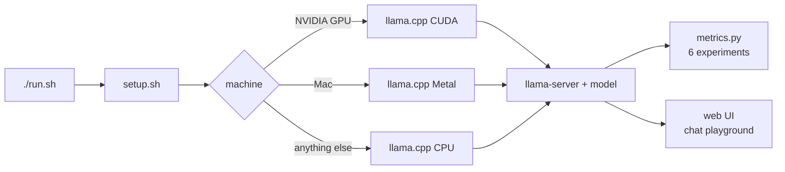
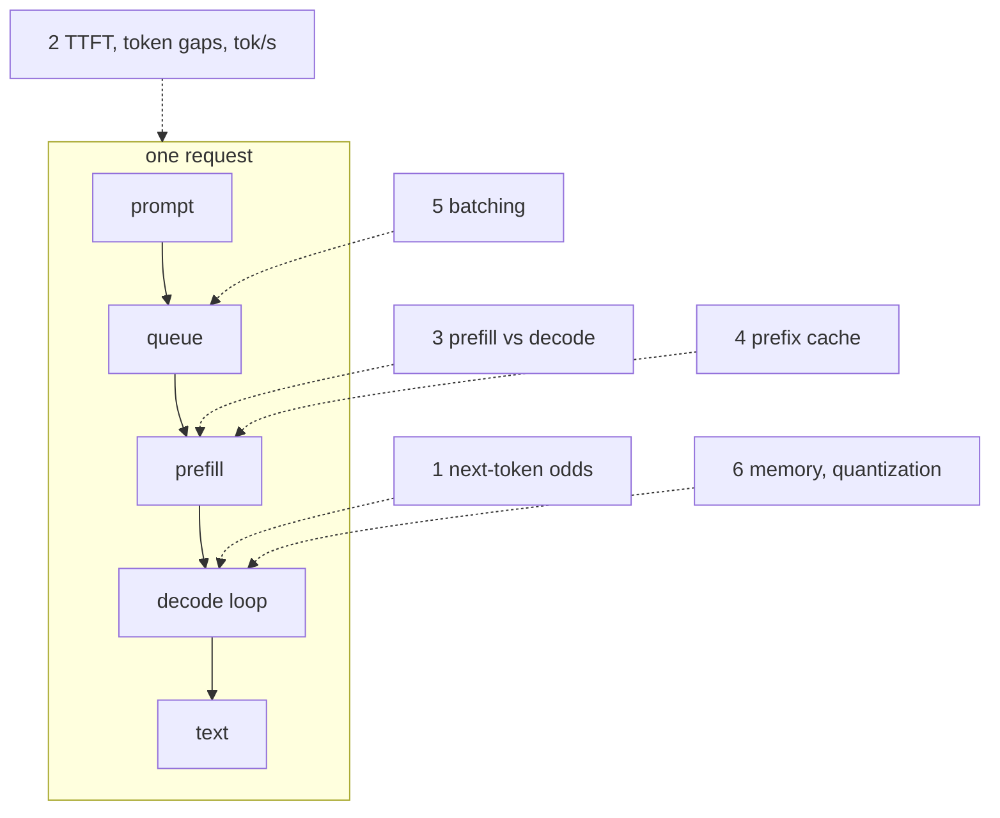
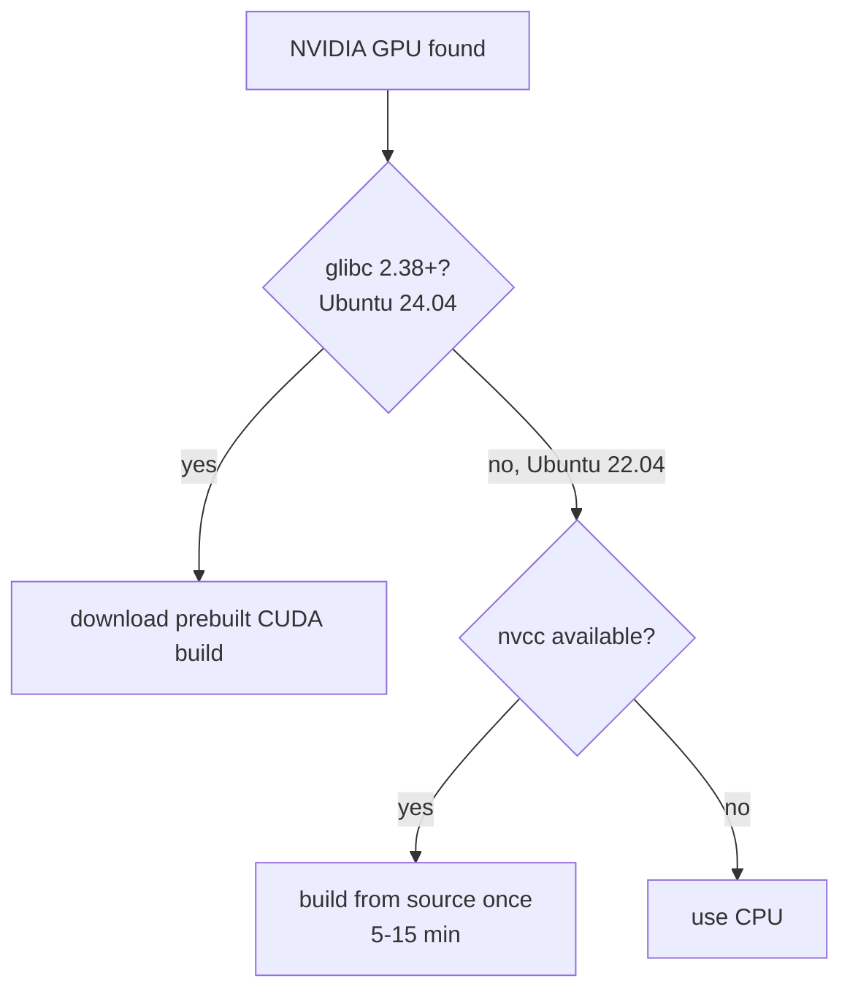

# Inference From Scratch

Run a small LLM with llama.cpp, chat with it in the browser, and measure what the workshop talks about.

```bash
git clone https://github.com/theaisocietyasu/inference-from-scratch
cd inference-from-scratch
./run.sh
```

First run downloads llama.cpp and a 0.5B model (about 500 MB). Later runs start in seconds.

## What run.sh does



## The experiments



| # | Experiment | You see |
| --- | --- | --- |
| 1 | Next-token probabilities | top 5 tokens after "The sky is" |
| 2 | One request | TTFT, gap between tokens, prefill and decode tok/s |
| 3 | Prefill vs decode | TTFT grows with prompt length, decode speed does not |
| 4 | Prefix cache | same prefix, second request skips most of prefill |
| 5 | Batching | 1 vs 4 requests at once: per-request speed vs total throughput |
| 6 | Memory | bits per weight, 4-bit vs 16-bit size, RAM in use |

```mermaid
gantt
    title Where the time goes in one request
    dateFormat X
    axisFormat %L ms
    section request
    queue    :0, 10
    prefill  :10, 120
    decode   :120, 1260
    section metric
    time to first token :crit, 0, 120
```



Rerun the numbers any time while the server is up:

```bash
python3 metrics.py --url http://127.0.0.1:8080
```


## GPU notes




## Knobs

| Variable | Default | What it changes |
| --- | --- | --- |
| `MODEL_URL` | Qwen2.5 0.5B Instruct, Q4_K_M | any GGUF URL, try a Q8_0 file to compare quantization |
| `PARALLEL` | 4 | requests the server batches together |
| `CTX` | 8192 | context shared by all slots |
| `PORT` | first free from 8080 | server port |
| `BACKEND` | auto | `cpu`, `cuda` or `metal` |
| `LLAMA_TAG` | b12119 | llama.cpp release |
| `SKIP_METRICS` | 0 | 1 starts only the server |

Windows: use WSL.

## Notes

- the biggest examples of engineering pieces: Voyager, vLLM
- cover basic principles behind systems programming
